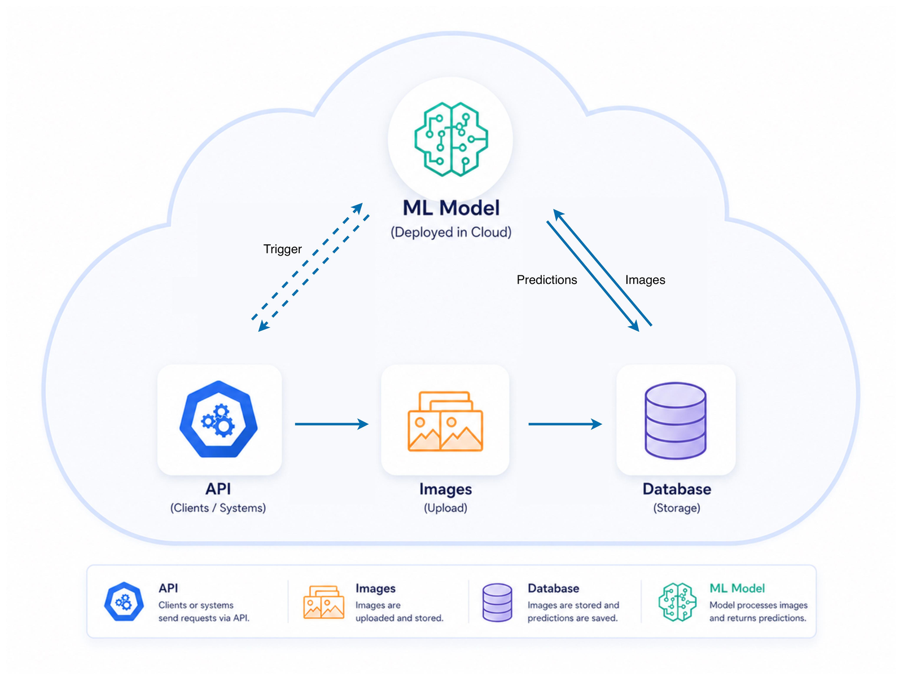

# Refund Classification

Cloud-based MLOps pipeline that classifies images of returned products in nightly batches. Built on AWS with Terraform: the REST API, training and batch prediction run as Docker containers on ECS Fargate, data and models live in S3, metadata in RDS PostgreSQL, logs in CloudWatch, and EventBridge schedules the jobs.



## How it works

1. The API uploads images to S3 and registers each one in RDS with status `PENDING`.
2. Every night, EventBridge starts the batch prediction task. It loads the active model, classifies all pending images and stores each prediction with model version and confidence in RDS.
3. Each run stores monitoring statistics (confidence distribution, low-confidence rate, class distribution), its status and its CloudWatch log stream. Failed images are marked `FAILED`; if the whole run fails, unprocessed images return to `PENDING`.
4. Once a month, EventBridge starts a training task. The new model and its metadata go to S3, the training run with all metrics to RDS.

Both tasks can also be started manually through the API.

**Model:** MobileNetV3-Large (PyTorch), fine-tuned on the top-10 subset of the [clothing dataset](https://github.com/alexeygrigorev/clothing-dataset-small) (3,781 images). Validation accuracy 85.9%, test accuracy 87.6%.

## Architecture Overview

```
                                   Developer
                                       │
                                       │ build_images.sh / push_images.sh
                                       ▼
                               Amazon ECR (Docker Images)
                                       │
                                       ▼
                            Amazon ECS Fargate Cluster
        ┌──────────────────────────────┼──────────────────────────────┐
        │                              │                              │
        ▼                              ▼                              ▼
    API Service                  Training Service             Batch Prediction
        │                              │                              │
        ▼                              ▼                              ▼
Application Load Balancer      Downloads dataset           Downloads pending images
        │                      from Amazon S3              from Amazon S3
        ▼                              │                              │
 REST API Requests                     ▼                              ▼
        │                     Trains new model              Loads active model
        │                              │                              │
        ▼                              ▼                              ▼
Uploads images               Uploads model & metadata      Stores predictions
to Amazon S3                 to Amazon S3                  in Amazon RDS
        │                              │                              │
        └───────────────► Amazon RDS PostgreSQL ◄─────────────────────┘
                             │
                             ├── datasets
                             ├── models
                             ├── training_runs
                             ├── images
                             ├── prediction_runs
                             ├── predictions
                             ├── prediction_class_stats
                             └── configs

Amazon EventBridge
    ├── Monthly → Training ECS Task
    └── Nightly → Batch Prediction ECS Task

Amazon CloudWatch
    └── API, training and prediction logs
```

## Repository Structure

```text
refund-classification/
├── app/                     # FastAPI REST API
├── config/
│   ├── pred/                # Prediction configurations
│   └── train/               # Training configurations
├── data/
│   └── clothing-dataset-small/
│       ├── train/
│       ├── validation/
│       └── test/
├── docker/                  # Dockerfiles
├── ml/                      # Training, prediction and model utilities
├── scripts/                 # Deployment and setup scripts
├── sql/                     # PostgreSQL schema
├── storage/                 # AWS and database utilities
├── terraform/               # Infrastructure as code
└── tests/                   # Integration tests
```

## Setup

Requirements: AWS account with configured credentials, Terraform, Docker, Python 3.

```bash
./scripts/setup.sh
```

The script creates the Python environment, deploys the infrastructure with Terraform, builds and pushes the Docker images, initializes and seeds the database, and runs the integration tests.

> **Warning:** `setup.sh` first runs `terraform destroy -auto-approve`. It deletes any existing deployment of this project, including the database, before deploying it again.

## Tests

The integration tests run against the deployed AWS infrastructure, without mocks.

| Command | Checks | Runtime |
|---|---|---|
| `pytest tests/test_aws_infra.py` | S3, RDS, ECS and API are deployed and reachable | |
| `pytest tests/test_pred.py` | A batch prediction task runs and writes predictions and statistics to RDS | ~5 min |
| `pytest tests/test_train.py` | A training task runs, uploads the model and registers it in RDS | ~30 min |
| `pytest tests/test_db_upserts.py` | Metadata in RDS is complete and consistent | |
